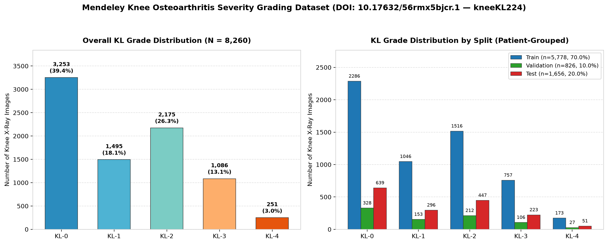

# Phân loại Mức độ Thoái hóa Khớp gối từ Ảnh X-quang (KL 0–4)

Repository chuẩn bị dữ liệu đầu vào (đã kiểm chứng toàn vẹn và phân chia theo bệnh nhân) cho bài toán phân loại 5 mức độ thoái hóa khớp gối theo thang **Kellgren–Lawrence (KL-0 đến KL-4)** từ ảnh X-quang.

---

## 1. Nguồn Dữ liệu & Giấy phép

- **Dataset**: Knee Osteoarthritis Severity Grading Dataset (Version 1)
- **Tác giả**: Pingjun Chen (University of Florida)
- **DOI**: `10.17632/56rmx5bjcr.1`
- **URL chính thức**: https://data.mendeley.com/datasets/56rmx5bjcr/1
- **Nguồn gốc dữ liệu gốc**: Osteoarthritis Initiative (OAI) — https://oai.epi-ucsf.org/datarelease/
- **Mã nguồn gốc của tác giả**: https://github.com/PingjunChen/GradingKneeOA
- **Giấy phép**: [CC BY 4.0](http://creativecommons.org/licenses/by/4.0) (yêu cầu ghi nhận tác giả và lưu ý điều khoản bên thứ ba đối với ảnh gốc từ OAI).
- **Bài báo trích dẫn**:
  > Chen, P., Gao, L., Shi, X., Allen, K., & Yang, L. (2019). *Fully automatic knee osteoarthritis severity grading using deep neural networks with a novel ordinal loss*. Computerized Medical Imaging and Graphics, 75, 84–92. https://doi.org/10.1016/j.compmedimag.2019.06.002

### Phần dữ liệu sử dụng
Từ archive gốc `KneeXrayData.zip` (`7,171,571,746` bytes, SHA-256: `3b4b93b3a3e2e2f059684f5d2b8bbd05aa7776d0199365fc6db51b93dc667505`), dự án sử dụng chính xác phân tập **`KneeXrayData/ClsKLData/kneeKL224/`** gồm 3 tập chuẩn `train`, `val`, `test` (**8,260 ảnh** từ **4,130 bệnh nhân** OAI).
- `auto_test` (1,526 ảnh) bị loại trừ khỏi `manifest.csv`/`split.csv` vì chứa ảnh cắt tự động YOLO của **chính các bệnh nhân trong tập `test`**.
- Không trộn thêm dataset ngoài; không chỉnh sửa ảnh gốc.
- Thư mục ảnh thô `data/raw/` được loại trừ trong `.gitignore` (không push lên GitHub do dung lượng ~171 MB và lưu ý bản quyền dữ liệu y khoa từ bên thứ ba OAI). Toàn bộ dữ liệu ảnh có thể tái tạo chính xác bit-for-bit bằng script bên dưới.

---

## 2. Cấu trúc Thư mục

```text
HOCMAY-XULYANHSO-/
├── data/
│   ├── raw/                         # (ignored in git) 8,260 ảnh PNG gốc tổ chức theo KL_0..KL_4
│   │   ├── KL_0/
│   │   ├── KL_1/
│   │   ├── KL_2/
│   │   ├── KL_3/
│   │   └── KL_4/
│   └── metadata/
│       ├── manifest.csv             # Danh sách 8,260 ảnh hợp lệ & metadata kiểm toán
│       ├── split.csv                # Phân chia Train / Validation / Test theo bệnh nhân
│       ├── source_provenance.json   # Thông tin nguồn, DOI, giấy phép, thời điểm tải
│       ├── source_index.csv         # Ánh xạ từng file với đường dẫn & CRC32 trong archive gốc
│       └── audit_details.json       # Chi tiết kiểm toán ảnh (hash, pixel, độ tương phản)
├── notebooks/
├── scripts/
│   ├── download_dataset.py          # Tải & xác minh CRC32 trực tiếp từ Mendeley Data
│   ├── prepare_dataset.py           # Kiểm toán ảnh & sinh manifest.csv, split.csv
│   └── verify_and_report.py         # Kiểm định toàn vẹn & tạo báo cáo + biểu đồ
├── reports/
│   ├── dataset_summary.md           # Báo cáo thống kê chi tiết
│   └── class_distribution.png       # Biểu đồ phân bố 5 lớp KL tổng thể & theo split
├── requirements.txt
└── README.md
```

---

## 3. Tóm tắt Thống kê Dataset

- **Tổng số ảnh hợp lệ**: **8,260** ảnh PNG grayscale (`224×224`, 1 kênh `L`)
- **Tổng số bệnh nhân (`patient_id`)**: **4,130** bệnh nhân (mỗi bệnh nhân có đúng 2 ảnh: gối trái `L` và gối phải `R`)
- **Ảnh lỗi / ảnh trùng SHA-256 / trùng pixel**: **0 / 0 / 0**
- **Rò rỉ bệnh nhân giữa Train / Validation / Test**: **0** (giữ nguyên split chính thức theo bệnh nhân từ Mendeley)

| Tập (`split`) | Số ảnh | Tỷ lệ (%) | Số bệnh nhân | KL-0 | KL-1 | KL-2 | KL-3 | KL-4 |
|---|---:|---:|---:|---:|---:|---:|---:|---:|
| `train` | 5,778 | 69.95% | 2,889 | 2,286 | 1,046 | 1,516 | 757 | 173 |
| `validation` | 826 | 10.00% | 413 | 328 | 153 | 212 | 106 | 27 |
| `test` | 1,656 | 20.05% | 828 | 639 | 296 | 447 | 223 | 51 |
| **Tổng** | **8,260** | **100.00%** | **4,130** | **3,253** | **1,495** | **2,175** | **1,086** | **251** |

Xem đầy đủ bảng tỷ lệ phần trăm, phân biệt cột nguồn vs cột tính toán và ghi nhận bất thường tại [reports/dataset_summary.md](reports/dataset_summary.md).



---

## 4. Hướng dẫn Tái tạo Dataset

### Bước 1: Cài đặt thư viện
```bash
python -m venv .venv
# Windows PowerShell:
.venv\Scripts\Activate.ps1
# Linux/macOS:
# source .venv/bin/activate

pip install -r requirements.txt
```

### Bước 2: Tải và xác minh ảnh gốc từ Mendeley Data
Script tự động truy vấn API chính thức của Mendeley Data, tải trực tiếp đúng phần `KneeXrayData/ClsKLData/kneeKL224/{train,val,test}` (~180 MB thay vì toàn bộ 7.17 GB chứa trọng số mô hình `.pth`), kiểm tra CRC32 từng file PNG và lưu nguyên bản vào `data/raw/KL_0/`..`KL_4/`:
```bash
python scripts/download_dataset.py
```
*(Nếu bạn đã tải thủ công toàn bộ `KneeXrayData.zip` về máy, có thể giải nén và kiểm chứng SHA-256 toàn bộ archive bằng:)*
```bash
python scripts/download_dataset.py --local-zip /path/to/KneeXrayData.zip
```

### Bước 3: Kiểm toán ảnh và tạo `manifest.csv`, `split.csv`
```bash
python scripts/prepare_dataset.py
```

### Bước 4: Chạy kiểm định toàn vẹn và sinh báo cáo
```bash
python scripts/verify_and_report.py
```

---

## 5. Lưu ý cho Bước Huấn luyện Mô hình

1. **Không dùng tập `test` để chọn mô hình hay tinh chỉnh siêu tham số**: Chỉ dùng `validation` để chọn checkpoint/hyperparameter và đánh giá cuối cùng đúng một lần trên `test`.
2. **Mất cân bằng lớp (Class Imbalance)**: `KL-0` (39.38%) lớn gấp ~12.96 lần `KL-4` (3.04%). Nên cân nhắc class weights, ordinal regression/loss hoặc focal loss.
3. **Định dạng 1 kênh Grayscale (`L`)**: Khi dùng backbone ImageNet 3 kênh, thực hiện chuyển đổi trong DataLoader (ví dụ `img.convert("RGB")`), không ghi đè ảnh gốc trong `data/raw/`.
4. **Ảnh có độ tương phản thấp**: Có 115 ảnh có độ lệch chuẩn cường độ sáng thấp (`std < 15.0`) được ghi nhận trong [reports/dataset_summary.md](reports/dataset_summary.md) và [data/metadata/audit_details.json](data/metadata/audit_details.json), chưa tự ý loại bỏ — cần đánh giá thêm (ví dụ áp dụng CLAHE trong pipeline tiền xử lý hoặc kiểm tra trực quan) trước khi quyết định lọc.
