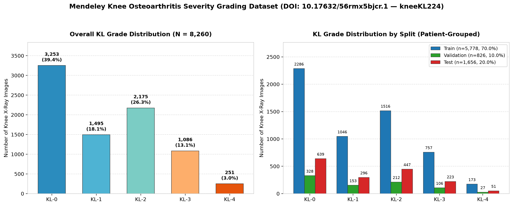

# Báo cáo Kiểm tra và Thống kê Dataset — Phân loại Mức độ Thoái hóa Khớp gối (KL 0–4)

## 1. Thông tin Nguồn Dữ liệu & Giấy phép

| Thuộc tính | Thông tin xác minh |
|---|---|
| **Tên dataset** | Knee Osteoarthritis Severity Grading Dataset |
| **Tác giả** | Pingjun Chen (University of Florida) |
| **DOI** | `10.17632/56rmx5bjcr.1` |
| **URL nguồn** | https://data.mendeley.com/datasets/56rmx5bjcr/1 |
| **Phiên bản** | Version 1 (công bố ngày `2018-09-04T01:04:16.808Z`) |
| **Nguồn gốc lâm sàng** | Osteoarthritis Initiative (OAI) - https://oai.epi-ucsf.org/datarelease/ |
| **Bài báo tham chiếu** | Chen, P., Gao, L., Shi, X., Allen, K., & Yang, L. (2019). Fully automatic knee osteoarthritis severity grading using deep neural networks with a novel ordinal loss. Computerized Medical Imaging and Graphics, 75, 84-92. https://doi.org/10.1016/j.compmedimag.2019.06.002 |
| **Mã nguồn chính thức của tác giả** | https://github.com/PingjunChen/GradingKneeOA |
| **Giấy phép** | CC BY 4.0 (http://creativecommons.org/licenses/by/4.0) |
| **Ngày tải dữ liệu** | `2026-11-26T10:34:16.165829+07:00` (`UTC: 2026-11-26T03:34:16.165829+00:00`) |
| **Archive gốc trên Mendeley** | `KneeXrayData.zip` (`7,171,571,746` bytes, SHA-256: `3b4b93b3a3e2e2f059684f5d2b8bbd05aa7776d0199365fc6db51b93dc667505`) |
| **Phần dữ liệu được chọn** | `KneeXrayData/ClsKLData/kneeKL224/` (`train`, `val`, `test`) |

### Giới hạn sử dụng & Lưu ý bản quyền
- Dataset trên Mendeley Data được phát hành theo giấy phép **CC BY 4.0** (yêu cầu ghi nhận tác giả Pingjun Chen và trích dẫn bài báo gốc).
- Ảnh X-quang gốc có nguồn gốc từ chương trình **Osteoarthritis Initiative (OAI)**; thông báo giấy phép trên Mendeley nêu rõ nội dung thuộc bên thứ ba có thể cần tuân thủ thêm điều khoản sử dụng dữ liệu của OAI.
- Toàn bộ ảnh thô (`data/raw/`) **không** được push lên GitHub (đã cấu hình trong `.gitignore`), chỉ lưu metadata (`manifest.csv`, `split.csv`, `source_provenance.json`, `source_index.csv`), script tái tạo và báo cáo.

### Lý do lựa chọn phần dữ liệu trong `KneeXrayData.zip`
Archive gốc `KneeXrayData.zip` (~7.17 GB) chứa 2 nhánh: `DetKneeData` (phát hiện khớp gối dạng `.h5` và trọng số YOLO `.pth`) và `ClsKLData` (phân loại độ KL gồm `kneeKL224`, `kneeKL299`, và ~5.7 GB checkpoint `.pth`).
- Đã chọn **`ClsKLData/kneeKL224/`** gồm 3 tập chuẩn `train`, `val`, `test` (tổng **8,260 ảnh**) vì đây là tập dữ liệu mặc định trong mã nguồn huấn luyện chính thức `ClsKL/train/train_kl.py` của Pingjun Chen và là chuẩn so sánh phổ biến trong các nghiên cứu KL grading.
- **Loại trừ `auto_test` (1,526 ảnh)**: qua đối chiếu tên file (`9003175_1.png`, `9003175_2.png`) và mã nguồn `DetJoint/preprocess/extract_yolo_det.py` của tác giả, `auto_test` là ảnh cắt tự động bằng YOLO từ **chính các bệnh nhân trong tập `test`**. Đưa `auto_test` vào tập chính sẽ gây trùng lặp bệnh nhân/mẫu kiểm thử.
- Không trộn thêm bất kỳ nguồn dataset nào khác; không thay đổi byte ảnh gốc (100% ảnh được kiểm chứng CRC32 khớp tuyệt đối với ZIP gốc trên Mendeley).

---

## 2. Phân biệt Thông tin Nguồn và Thông tin Script Tính toán

| Cột | File | Nguồn gốc | Chi tiết xác minh |
|---|---|---|---|
| `file_name` | `manifest.csv` | **Trực tiếp từ nguồn** | Tên file gốc trong `KneeXrayData.zip` |
| `kl_grade` | `manifest.csv`, `split.csv` | **Trực tiếp từ nguồn** | Tên thư mục nhãn `0..4` trong `ClsKLData/kneeKL224` |
| `source_split` | `manifest.csv` | **Trực tiếp từ nguồn** | Thư mục chia tập chính thức (`train`, `val`, `test`) trong archive |
| `patient_id` | `manifest.csv`, `split.csv` | **Trực tiếp từ nguồn (quy ước tên file xác minh bởi mã tác giả)** | Mã bệnh nhân OAI (7 chữ số đầu tên file), xác minh trong `DetJoint/preprocess/split_train_val_test.py` (`# organize patients according to the R leg's kl grade`) |
| `knee_side` | `manifest.csv` | **Trực tiếp từ nguồn (quy ước tên file xác minh bởi mã tác giả)** | Hậu tố `L` (trái) / `R` (phải), xác minh qua `key_left, key_right = ele + "L", ele + "R"` trong mã nguồn tác giả |
| `image_id` | `manifest.csv`, `split.csv` | **Script gán** | Tên file không phần mở rộng (`path.stem`), đảm bảo duy nhất 1-1 |
| `relative_path` | `manifest.csv` | **Script tổ chức** | Đường dẫn tương đối từ thư mục gốc project (`data/raw/KL_<grade>/<file_name>`) |
| `width`, `height`, `channels`, `image_format`, `file_size`, `sha256`, `status` | `manifest.csv` | **Script tính toán** | Đọc trực tiếp từ file ảnh thật bằng Pillow & `hashlib.sha256` |
| `split` | `split.csv` | **Giữ nguyên split chính thức từ nguồn** | Ánh xạ `train -> train`, `val -> validation`, `test -> test` (ưu tiên #1; đã kiểm chứng 0 rò rỉ bệnh nhân) |

*(Lưu ý: không có trường `study_id` trong archive gốc nên không tự suy đoán hay điền cột này.)*

---

## 3. Thống kê Phân bố Lớp và Phân chia Dữ liệu

### 3.1. Phân bố 5 lớp KL (Toàn bộ tập dữ liệu)

| KL Grade | Mô tả lâm sàng | Số lượng ảnh | Tỷ lệ (%) |
|---|---|---:|---:|
| `KL-0` | Normal | 3,253 | 39.38% |
| `KL-1` | Doubtful | 1,495 | 18.10% |
| `KL-2` | Minimal | 2,175 | 26.33% |
| `KL-3` | Moderate | 1,086 | 13.15% |
| `KL-4` | Severe | 251 | 3.04% |
| **Tổng cộng** | | **8,260** | **100.00%** |

- **Mất cân bằng lớp (Class Imbalance)**: Lớp `KL-0` chiếm **39.38%** trong khi `KL-4` chỉ chiếm **3.04%** (tỷ lệ chênh lệch `KL-0 / KL-4` xấp xỉ **12.96 : 1**). Khi huấn luyện mô hình cần cân nhắc weighted loss, ordinal loss hoặc oversampling/focal loss.

### 3.2. Phân chia Train / Validation / Test (Giữ nguyên Split chính thức theo Bệnh nhân)

| Tập dữ liệu (`split`) | Nguồn (`source_split`) | Số ảnh | Tỷ lệ ảnh (%) | Số bệnh nhân (`patient_id`) | Tỷ lệ bệnh nhân (%) |
|---|---|---:|---:|---:|---:|
| `train` | `train` | 5,778 | 69.95% | 2,889 | 69.95% |
| `validation` | `val` | 826 | 10.00% | 413 | 10.00% |
| `test` | `test` | 1,656 | 20.05% | 828 | 20.05% |
| **Tổng cộng** | | **8,260** | **100.00%** | **4,130** | **100.00%** |

- Tỷ lệ thực tế là **69.95% / 10.00% / 20.05%** (sát mục tiêu 70% / 10% / 20%).
- Mỗi bệnh nhân trong toàn bộ **4,130** bệnh nhân có đúng **2 ảnh** (1 gối trái `L`, 1 gối phải `R`), và cả hai gối luôn nằm trong **cùng một tập** (`train`, `validation`, hoặc `test`).
- Tập `test` được tách cố định và **tuyệt đối không** sử dụng cho việc chọn mô hình hay tinh chỉnh siêu tham số.

### 3.3. Phân bố 5 lớp KL trong từng tập Train / Validation / Test

| KL Grade | Train (n, %) | Validation (n, %) | Test (n, %) | Tổng (n, %) |
|---|---:|---:|---:|---:|
| `KL-0` | 2,286 (39.56%) | 328 (39.71%) | 639 (38.59%) | 3,253 (39.38%) |
| `KL-1` | 1,046 (18.10%) | 153 (18.52%) | 296 (17.87%) | 1,495 (18.10%) |
| `KL-2` | 1,516 (26.24%) | 212 (25.67%) | 447 (26.99%) | 2,175 (26.33%) |
| `KL-3` | 757 (13.10%) | 106 (12.83%) | 223 (13.47%) | 1,086 (13.15%) |
| `KL-4` | 173 (2.99%) | 27 (3.27%) | 51 (3.08%) | 251 (3.04%) |
| **Tổng cộng** | **5,778 (100.00%)** | **826 (100.00%)** | **1,656 (100.00%)** | **8,260 (100.00%)** |

---

## 4. Kết quả Kiểm tra Toàn vẹn Dữ liệu & Bất thường

| Hạng mục kiểm tra | Kết quả thực tế | Trạng thái |
|---|---|---|
| Tổng số ảnh trong `manifest.csv` | **8,260** | PASS |
| Số ảnh hợp lệ (`status == "ok"`) | **8,260** | PASS |
| Số dòng trong `split.csv` | **8,260** (khớp 100% với `manifest.csv`) | PASS |
| Ảnh lỗi / không đọc được / cắt cụt | **0** | PASS |
| Ảnh thiếu nhãn hoặc nhãn ngoài `0..4` | **0** | PASS |
| Trùng `image_id` (manifest / split) | **0 / 0** | PASS |
| Ảnh xuất hiện ở nhiều hơn 1 tập | **0** | PASS |
| ID thiếu hoặc lệch giữa 2 CSV | **0 / 0** | PASS |
| Nhãn `kl_grade` lệch giữa 2 CSV | **0** | PASS |
| Đường dẫn `relative_path` không tồn tại | **0** | PASS |
| Trùng file theo SHA-256 | **0 nhóm** (0 file) | PASS |
| Trùng nội dung pixel khác tên file | **0 nhóm** | PASS |
| Rò rỉ bệnh nhân (`patient_id`) giữa các tập | Train∩Val: **0**, Train∩Test: **0**, Val∩Test: **0** | PASS |
| Quy ước tên file chuẩn `^\d+[LR]\.png$` | **8,260 / 8,260** (100.00%) | PASS |

### Thông số kỹ thuật ảnh
- **Định dạng ảnh (`image_format`)**: `{'PNG': 8260}`
- **Kích thước (`width x height`)**: `{'224x224': 8260}`
- **Không gian màu (`color_mode`) & số kênh (`channels`)**: `{'L': 8260}` (số kênh: `{1: 8260}`)
- **Dung lượng file**: min `12,468` bytes, median `22,272` bytes, max `29,263` bytes, tổng `170.90` MB.

### Ghi nhận bất thường & Lưu ý tiền xử lý
- **Độ tương phản ảnh**: Phát hiện **115** ảnh có độ lệch chuẩn cường độ sáng thấp (`std < 15.0`). Theo nguyên tắc không tự ý loại bỏ ảnh gốc, toàn bộ các ảnh này được **giữ nguyên** để phục vụ bước tiền xử lý/đánh giá chuyên sâu sau này.
  - Ví dụ: `9019287L` (KL-0, mean=134.63, std=10.77), `9048979R` (KL-0, mean=52.41, std=8.57), `9102958L` (KL-0, mean=50.64, std=12.2), `9102958R` (KL-0, mean=52.47, std=11.13), `9116534R` (KL-0, mean=50.04, std=10.01), `9132486L` (KL-0, mean=52.32, std=10.84), `9132486R` (KL-0, mean=55.11, std=8.64), `9140556L` (KL-0, mean=70.44, std=12.55)
- **Trùng nội dung pixel**: Không phát hiện hai ảnh nào có nội dung pixel giống hệt nhau.
- **Ảnh grayscale 1 kênh (`L`)**: Nếu sử dụng các mô hình backbone ImageNet (ResNet, DenseNet, EfficientNet, ViT...) yêu cầu đầu vào 3 kênh RGB, cần chuyển đổi trong DataLoader (ví dụ `img.convert("RGB")`) mà không chỉnh sửa file ảnh gốc trong `data/raw/`.
